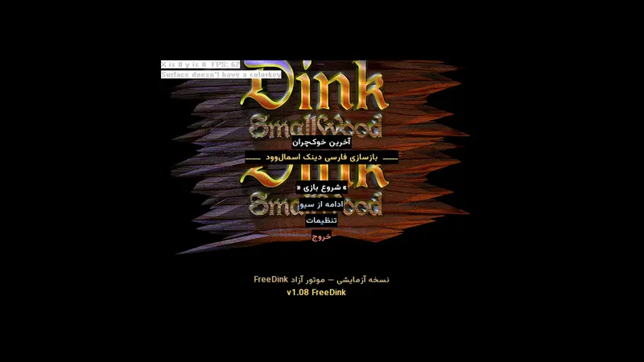
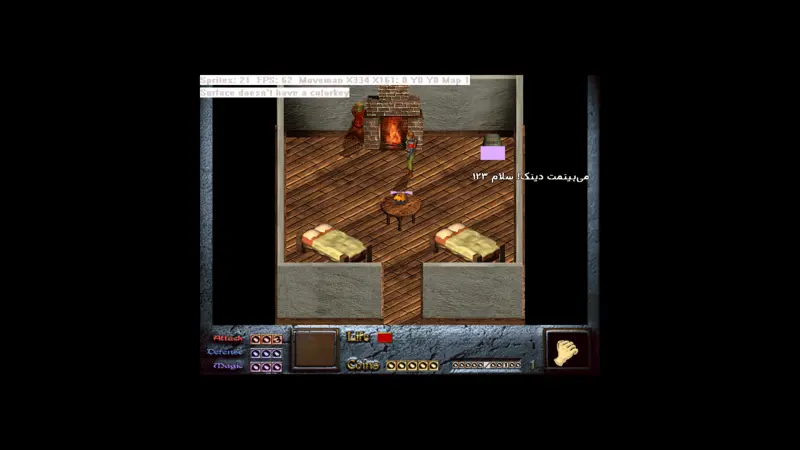
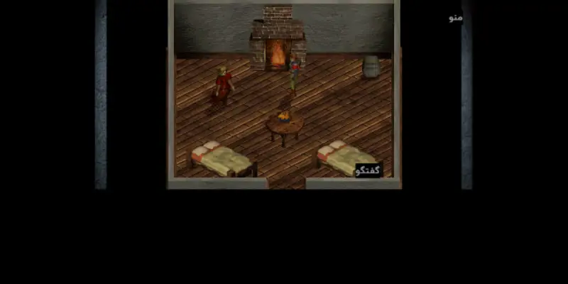
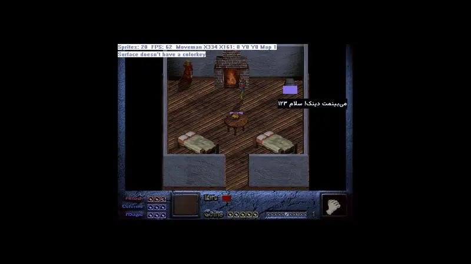

# آخرین خوک‌چران — The Last Pigkeeper

بازسازی کامل و فارسیِ بازی کلاسیک **Dink Smallwood** برای اندرویدهای مدرن — روی موتور آزاد GNU FreeDink،
با داستان کاملاً جدید («آخرین خوک‌چران»)، رندر فارسی بومی، کنترل لمسی، و تست‌های خودکار سخت‌گیرانه.

A complete Persian-language remake of the classic action-RPG **Dink Smallwood** for modern Android,
built on the GNU FreeDink engine with a brand-new story, native RTL/Persian text shaping, touch
controls, and a strict CI pipeline (desktop behavioural suite + real Android-emulator E2E).

## 📱 دانلود نسخه آزمایشی
آخرین APK دیباگ از تب **Actions → Android → pigkeeper-debug-apk** (arm64، ~۳۵MB با کل بازی داخلش).

## ✨ وضعیت در یک نگاه
| فاز | وضعیت |
|---|---|
| ۰–۱ پایه‌سازی و احیای موتور | ✅ کامل |
| ۲ فارسی‌سازی و سیستم‌های ریمیک (شکل‌دهی فارسی، تایپ‌رایتر، سیو اتمیک+اتوسیو، ژورنال، فلگ‌ها، شب/روز) | ✅ کامل |
| ۳ اندروید (APK، کنترل لمسی E2E، بوت امولاتور در CI) | 🔄 ۳-۰ تا ۳-۷ کامل |
| ۴ بهینه‌سازی (۶۰fps تأییدشده در CI، تله‌متری PERF با کف سخت‌گیرانه) | 🔄 دور ۱ و ۲ انجام شد |
| ۵ داستان «آخرین خوک‌چران» (سه پرده کامل نوشته شده — بخش ب ROADMAP) | 📝 متن کامل، پیاده‌سازی مانده |

نقشه راه کامل + کتاب داستان: **[ROADMAP.md](ROADMAP.md)** · مرجع فنی موتور: **[docs/ENGINE.md](docs/ENGINE.md)**

## 🖼️ مدارک (خروجی واقعی CI)
| | |
|---|---|
|  صفحه عنوان فارسی ریمیک |  رندر فارسی داخل بازی |
|  لمس E2E روی امولاتور (دینک با سوایپ حرکت کرده) |  شب موتوری (۳۰٪ تاریک‌تر، سنجیده‌شده) |

## 🔧 ساختار
- `engine/` — GNU FreeDink 109.6 + پچ‌های ریمیک (فارسی/لمس/سیو/پرف — همه با کامنت `remake`)
- `pigkeeper/` — D-Mod داستان جدید (روی دیتای پایه سوار می‌شود)
- `android-project/` — پروژه Gradle/NDK (پکیج `ir.pigkeeper.dink`)
- `tools/` — ffextract (آرشیوهای dir.ff)، اسکریپت‌های CI
- `fetch-data.sh` — دیتای آزاد پایه از GNU (sha256-پین‌شده؛ در گیت نیست)
- `docs/proof/` — اسکرین‌شات‌های مدرک از ران‌های CI

## 🧪 تضمین کیفیت (هر push)
دسکتاپ: بیلد + بوت کامل تا گیم‌پلی + ~۲۵ assert رفتاری (فارسی، سیو/ژورنال/فلگ/شب، fps≥30، بوت≤15s)
اندروید: بیلد APK + ممیزی محتوا + **بوت روی امولاتور واقعی** + تزریق لمس + کف fps≥20

## ⚖️ لایسنس
کد موتور و پچ‌ها: **GPL-3.0-or-later** · دیتای پایه: لایسنس‌های آزاد (`gamedata/licenses/`) ·
داستان و محتوای جدید ریمیک: GPL-3.0-or-later / CC-BY-SA 4.0 · فونت وزیرمتن: OFL (`fonts/`)
